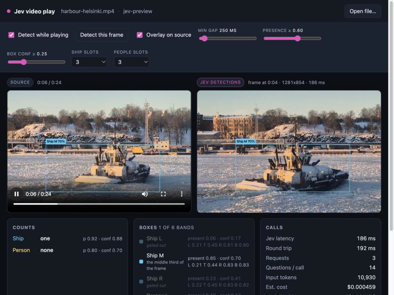

# Jev video play

Plays a video file and, while it plays, sends frames to Jev (TypeSafe's System
One model) to find **ships** and **people**. The boxes Jev returns are drawn on
a panel next to the original video, which stays clean.



## How it works

The browser plays the video and grabs frames straight off the `<video>`
element, scaling each one into Jev's image limits (256–1568 px per side,
78,400–2,458,624 total pixels) and encoding it as a baseline JPEG. Each frame
is POSTed to the local backend, which forwards it to
`POST https://api.typesafe.ai/v1/systemone` as a multipart request.

Everything about one frame goes in **a single call**. Jev evaluates every
question in parallel against the same state, so a frame's whole question set —
around 80 of them at the defaults — costs one round trip (~300–500 ms):

| Question | Type | Asks |
| --- | --- | --- |
| `ship_count` / `person_count` | Choice | `0`, `1`, `2` … `10`, `more` |
| `<kind>_<n>_present` | Noul | "Is there a ship or boat whose centre lies in the left third of `frame`?" |
| `<kind>_<n>_box` | Box | "the ship or boat whose centre lies in the left third of `frame`" |

The count Choice has **one option per exact number** rather than a
`none`/`one`/`several` bucket, so the answer carries a real distribution: a
bridge scene comes back `4` at p=0.79 with 0.18 on `5`, instead of collapsing
to "several". It enumerates to 10 and then says `more`; weight landing in
`more` means the frame holds more targets than there are slots to box them. The Counts card draws the whole
distribution as a histogram, picked bin highlighted.

Three design points, all forced by how Box actually behaves:

- **One box per question.** Box returns exactly one rectangle, so finding
  several ships means asking several questions.
- **Slots are regions, not ordinals.** Asking for "the second ship from the
  left" returns the same salient vessel as "the leftmost ship" — on a test
  frame all three ordinal slots came back within a few percent of each other.
  Splitting the frame into regions and asking for one target per region is what
  actually separates instances. Up to four slots those regions are vertical
  bands named in words ("the left third"); past that the words stop working
  ("the seventh tenth") and strips get too narrow to hold a person, so the
  frame is split into a 2-row grid described by explicit percentages, at any
  count. Ten slots on a 512-wide frame would be 51px strips; a 5x2 grid gives
  102x192 cells. An
  odd count gives the top row the extra cell and widens the bottom row to span
  the frame, so the grid always tiles it rather than leaving a hole in a
  corner: 7 slots is four cells over three. The default of 10 is 5x2.
  More slots also sharpen identification, because each Choice gets a smaller
  region holding one person: going from 3 bands to 10 cells took Riker from
  0.67 to 0.96 on the same frame.
- **Every box is gated by a Noul.** Box has no "not found" answer: ask it about
  an empty frame and you still get four edges. The companion Noul asks whether
  that band holds the target at all, and the page drops boxes whose gate is
  below the threshold. A frame of test pattern returns a box with confidence
  0.1 and `none` from the Choice — the gate is what makes that readable.
- **Presence and box confidence are not the same number.** The Noul gate says
  whether the target is there; the Box's own confidence says how sure it is of
  the exact edges, and it runs low on small, soft or low-resolution targets
  that were found perfectly well. Filtering on it throws away true positives: a
  bridge scene with three people returned all three at presence 0.94–0.98 while
  two of the boxes sat at confidence 0.14 and 0.21. So presence does the
  gating, and a box below `SURE` (0.35) is drawn **dashed** rather than
  discarded. The reverse case proves the split — on a harbour frame a person
  box scored confidence 0.71 with presence 0.43, and the gate correctly
  dropped it.

Bands overlap, so a ship spanning two of them answers both. Boxes covering the
same thing (IoU ≥ 0.5) collapse into the most confident one, client-side.

## Layout

```
build-python.sh      prepare the Python app
run-python.sh        launch it
run-server.sh        launch it on 0.0.0.0 for phone testing
create-cloudflare-tunnel.sh   expose that through a Cloudflare quick tunnel
ARCHITECTURE.md      how the system works, in detail
CHANGELOG.md         what changed, newest first
python/              the Python implementation
  app.py             backend: serves the page, calls Jev
  cast.py            builds cast.json from the video's cast list
  static/            the page itself
samples/             bundled clip
runtime/             debug cases (gitignored)
.env                 your API key
```

[ARCHITECTURE.md](ARCHITECTURE.md) covers the request pipeline, the question
model, the filtering chain and the cast lookup in depth.
[CHANGELOG.md](CHANGELOG.md) records what has changed.

The scripts are named for the implementation so a port to another stack can
sit beside `python/` with its own `build-*.sh` / `run-*.sh` pair, sharing the
key and the samples.

## Setup

The key lives in `.env` at the project root (or in `python/.env`, which wins):

```
JEV_API_KEY=apikey_...
```

`TYPESAFE_API_KEY` works too. Dependencies are declared inline (PEP 723), so
uv fetches them on first run — there is nothing to install.

To do that fetch up front instead of on the first run:

```bash
./build-python.sh
```

It resolves the dependency block with `uv sync --script`, then checks that the
Python and browser sources parse.

## Run

```bash
./run-python.sh
```

That plays the bundled sample and opens the page for you. Name a file to play
your own, and any `python/app.py` flag still works:

```bash
./run-python.sh ~/clips/harbour.mp4 --max-people 0
```

`run-python.sh` checks for uv and an API key first, and falls back to the
sample when you pass flags but no file. To skip it and open the page yourself:

```bash
./python/app.py samples/harbour-helsinki.mp4
```

Either way the app lands on http://127.0.0.1:8000. With no file at all, the
page's **Open file…** button takes any video your browser can play, and
**Open URL** plays any http(s) URL — proxied through the backend so frame
capture is not blocked by cross-origin restrictions. YouTube and other
`yt-dlp`-supported watch URLs play too, resolved and merged server-side (needs
`yt-dlp` on the machine running the app).

On iOS those streams are served as HLS instead of a fragmented MP4 — Safari
will not open a fragmented MP4 in a plain `<video>`. The page detects iOS and
points the video at an `.m3u8` playlist, which plays natively; desktop keeps
the fragmented-MP4 path. The source URL and the IP it resolves to are not
shown on the page: they go to the server console and to `GET /api/last`.

```bash
./python/app.py --help
```

| Flag | Default | Meaning |
| --- | --- | --- |
| `--model` | `jev-preview` | Box needs Jev 1.14; `jev-preview` is its alias |
| `--max-ships` | `10` | Frame regions searched for ships |
| `--max-people` | `10` | Frame regions searched for people |
| `--port` | `8000` | |
| `--open` | off | Open the page in your browser |
| `--version` | — | Print the version and exit |

## Identifying characters

Each person region also gets a Choice over the cast, so a box reads
`Picard 97%` instead of `Person L`. This always runs when a cast is loaded;
with no cast the Choice is skipped and boxes keep their region labels.

Identity is a **Choice, not a Box**, and that was the whole finding. Asking Box
directly for "the person in `frame` who is Lieutenant Worf" scores 0.06–0.15
and returns most of the frame. Locating the person by band and then naming them
against a closed cast reaches 0.68–0.97. Jev knows the series unaided — asked
which show a frame came from, it answered *The Next Generation* at p=0.90 — but
**names alone are not enough**: adding a one-line visual description to each
cast option roughly tripled box confidence in testing, so every option in
`CHARACTERS` carries one.

The Choice reuses the Box's exact band wording, so both questions land on the
same person within the single call.

A box that resolved to a named character is drawn **green** instead of yellow,
so an identified face reads at a glance. A name is only drawn when its
probability clears `NAME_MIN` (0.40) and is not
`other`; below that the box keeps its band label rather than asserting a wrong
name. Measured on the bundled episode: Picard 0.97, Troi 0.88, Data 0.69, Riker
0.67 — and a middle-band guess of Troi at 0.31 correctly fell back to
`Person M`. Where two characters genuinely share a band the probabilities split
honestly (Picard 0.46 against Worf 0.38), and the Boxes list shows the runners-up.

### A Box per character (crimson)

Every frame also gets one Box per named character, each gated by its own Noul,
drawn in **crimson**. This runs alongside the region search on every call, so
both methods answer the same frame and can be compared directly.

It is the weaker method on its own, but it is not redundant — the two fail
differently:

| | Region + Choice (green) | Per-character Box (crimson) |
| --- | --- | --- |
| Finds | one name per region | any character, anywhere |
| Confidence | up to 0.97 | 0.10–0.69 |
| Misses | a character sharing a region with a louder one | little |
| False positives | rare, the cast Choice is closed | real: Dr Crusher at presence 0.62 in a frame she is not in |
| Cost | 1 question per person region | 22 questions, ~1,100 extra tokens |

On a bridge frame the region method returned Worf, Data and an unnamed person,
while the per-character pass also found **Picard at presence 0.80** — he was
seated in the same band as Worf and lost it. On a ready-room frame it found
**Troi at 0.93** where the region pass managed only an unnamed box. In both
cases it also floated absent characters at 0.44–0.62, which the presence gate
has to catch, so raise **Presence ≥** when using it.

Repeating the visual description inside each Box question is what makes it work
at all: a bare "the person in `frame` who is Lieutenant Worf" scores 0.06–0.15.

The cast size is a cost lever: each character adds two questions, so a
15-character cast is 30 questions on its own. Trim it with `cast.py --limit`. The crimson chip hides the boxes from the drawing but does not stop
them being asked for.

### Generating the cast from the video

`cast.py` builds the character list from the video's own cast instead of the
hand-written one:

```bash
./python/cast.py "Star Trek - TNG - S02E04 - The Outrageous Okona.mp4"
```

It reads the title, season and year out of the filename, asks **Brave Search**
for the right page, reads the cast off it, and writes `cast.json` beside
`app.py`.

**Three sources, in order.** Wikipedia first, because only it records which
seasons a character appears in. When it has no usable cast — a show too new or
too small for an article with a cast table — the lookup falls back to
[Who's That?](https://whosthatcast.com), whose pages ship a plain
`Character — played by Actor` list behind the app.

Those pages are keyed by TMDB id and ignore the slug, so `/tv/287620` is
enough. Searching the site directly does not find them (Brave returns the home
page), but searching for the title does return TMDB, whose URLs carry the id.
There is no season filter there, so the fallback gives the whole cast.

**Films and shows take different paths.** No season in the filename means a
film, so it looks for the film's article and reads the `== Cast ==` bullet
list (`* [[Actor]] as [[Character]]`) instead of a season table. Release names
are cleaned first: `enders.game.2013.720p.bluray.x264-sparks` becomes *enders
game* from 2013, and the release year is taken as the last year before the
first quality tag, which keeps `Blade.Runner.2049.2017.2160p` as *Blade Runner
2049* from 2017 rather than a film made in 2049. The app picks that up on startup and falls back to the
built-in list when it is absent.

Brave does the searching; the cast itself comes from the table on the page
Brave finds, because snippets alone are not a cast list — an "`<actor>` as `<character>`"
sweep over ten results returned four hits, one of them `Ro Laren. If`. The
Cast tables differ more than they look. Star Trek has one table with the
seasons as numbered columns; Doctor Who has a dozen, each covering a span of
seasons with an extra `Appearances` column in between; Battlestar labels the
column `Performer` rather than `Actor`. Cells may be separated by `||` on one
line, a character can carry `rowspan` across several rows, and `colspan`
sometimes appears without the pipe that should follow it. So columns are found
by their headers and the rows are laid out on a grid that honours both spans —
guessing by position produced episode titles as character names.

The page's table also records which seasons each character appears in, and
**filtering to the episode's season is what makes this better than the
hand-written list**: season 2 has Pulaski and not Beverly Crusher, and Beverly
was the false positive the per-character pass kept producing at presence 0.62.
With the generated cast that frame identifies Picard, Riker, Deanna Troi and
Wesley Crusher, and Riker's score went from 0.75 to 0.92.

Names that are titles are left alone: stripping honorifics turned **The
Doctor** into "The", which is what the overlay then called him. A name whose
remainder would be an article keeps its full form, and so does one that starts
with an article, so The Doctor and The Master stay whole.

Descriptions come from the character's own wiki page: Brave finds it, and the
infobox supplies species, hair and eyes where the wiki carries them. Gender is
read from the page's pronouns as a floor, because many wikis have no such
field, and it is worth the most on its own — on a frame of the Thirteenth
Doctor, "Look for a woman" lifts the presence gate from 0.57 to 0.83 while the
bare name never clears the 0.60 default.

A character whose actor changes between seasons is described per incarnation.
The cast table carries a qualifier beside the name (`Thirteenth`, `Fugitive`),
which picks the page, so series 12 describes Jodie Whittaker's Doctor and not
Capaldi's. Values annotated for an adaptation, like `brown (novels) blue
(film)`, resolve to the screen one.

Where no wiki page helps, a plain search is the last resort, and it is the
weak part. Each character gets one more Brave search for a
line about how they look, but snippets are usually biography: it found "pale
gold skin tone" for Data and nothing usable for Worf. So anything in
`KNOWN_LOOKS` wins over the searched text, and a snippet that scores below two
appearance words is dropped rather than used — a wrong description is worse in
a Box question than none. Sentences about the role rather than the person are
rejected outright (`incarnation`, `regenerated`, `viewers`, `this version`…):
a search for The Doctor returned *"gone from a young man to a much older one
despite being renewed"*, which describes a previous incarnation, and on a frame
of the Thirteenth the presence gate answered **0.19** while the Box had already
found her with 0.76 confidence. Dropping that line takes the gate to 0.53 —
still under the 0.60 default, where a correct appearance line reaches 0.80. On the TNG cast that leaves Q, Mr. Homn, Lwaxana Troi
and Sonya Gomez with names only, and **their presence gates run mushy**, around
0.54–0.59 on frames they are not in. They stay under the 0.60 default, but not
by much: raise **Presence ≥** or trim the cast with `--limit` if a
description-less character starts appearing.

| Flag | Meaning |
| --- | --- |
| `--season N` | Override the season parsed from the filename |

A show that numbers both "seasons" and "series" from 1 offers two answers for
`S12`: Doctor Who's 1974 season and its 2020 series. The year in the filename
decides — `Doctor Who (2005) - S12E10` takes the 2020 cast, `(1963)` takes the
1974 one — by comparing against the year printed in each season's column
header. Without a year in the filename both are kept.
| `--limit N` | Keep at most N characters; 0 (the default) keeps the whole cast |
| `--no-descriptions` | Skip the per-character searches |

Non-Latin casts work: a character whose name has no ASCII form gets a
positional key, so a Cyrillic cast does not collapse into one entry.
| `--out PATH` | Write somewhere other than `python/cast.json` |

It needs `BRAVE_SEARCH_API_KEY` in `.env`. Wikipedia's User-Agent policy
rejects requests without a URL-shaped contact, so the script sends
`+http://localhost`; set `WIKI_CONTACT` to your own if you run it anywhere
shared.

**Playback is held until the cast has loaded.** The cast decides which
questions get asked, so playing before it lands would detect the new video
against the previous show's characters. While it builds, the source pane shows
`Loading cast… Ns` over the video.

Detection is held too, for the same reason. **Play anyway** releases both, and
the snapshot records the cast a call actually used, so an early detection is
still traceable.

The video controls stay visible and there is a **Play anyway** button, because
a cast rebuild takes about a second per character and rebuilds queue behind one
lock — load two files in a row and the second waits for both. With the controls
hidden and no elapsed time, that was indistinguishable from a video that would
not play.

**Opening a file in the page rebuilds the cast for it.** `cast.json` is read
once at startup, so without this, loading a different show would keep asking
about the previous one's characters. The header shows which cast is loaded
(`cast: Star Trek TNG season 2`) and says `looking up…` while it works, which
takes roughly fifteen seconds for a full cast because the per-character
searches are rate limited. Re-opening the same show costs nothing: the backend
compares the title and season first and answers `unchanged`, which also picks
up a `cast.py` run made while the server was up.

Switching the same show to another season is enough to change the cast —
loading an `S05E01` file swapped Pulaski and Sonya Gomez for Beverly Crusher,
Gowron and Kurn, and expanded `Crusher` into `Beverly Crusher` and `Wesley
Crusher` now that both are in it.

**If no cast can be found, the cast is cleared** rather than left on the
previous show's — another show's characters on this video is worse than none.
The header turns red and reads `cast: none found for <title>`, and the reason
goes to the error line. The empty result is written to `cast.json` too, so a
restart does not bring the old cast back.

A YouTube URL has no filename to parse a show from, so opening one clears the
cast the same way — the header reads `cast: none` — instead of keeping the
previous show's.

The cast readout in the header is a button. Clicking it opens an editor where
you can type a cast by hand — characters plus what they look like — along with
the show name, season and episode. Saving writes it to `python/casts.json`,
keyed by show/season/episode, so opening that show again reuses your entry
instead of re-searching; the editor's **Saved casts** list loads any entry back.

With no cast, people are still found and boxed, just not named: the
per-character questions and the identity Choice are skipped, which on a
10-slot frame is 21 questions instead of 61.

Delete `cast.json` to go back to the built-in list.

The fallback cast lives in `DEFAULT_CAST` in `python/app.py` — edit that dict for a different
show. Identification costs one extra question per person band and roughly
doubles input tokens (1,324 → 2,662 on a 512×384 frame), so switch it off for
anything that isn't Star Trek.

## Events

An expandable **Events** panel at the foot of the page tails what the backend
is doing, over server-sent events: each step of a cast lookup as it happens,
transcodes, snapshots, and failures including a detection that errors.

It carries what you do, too — opening a file, the dimensions and duration it
turned out to have, a file the browser could not decode, **Play anyway**.
Opening a file happens entirely in the browser, so without this the log jumps
from one show's cast to another with nothing explaining why. Cast
lookups take tens of seconds and were otherwise just a spinner.

Successful detections are deliberately not logged — one line per frame buried
everything else, and the Calls card already carries latency, tokens and the
question count.

The last 400 events are kept in memory and the recent 80 are replayed when the
page connects, so reloading does not lose the history. `GET /api/events`
returns them as JSON.

## Snapshotting a validation case

**Snapshot case** writes everything behind the frame on screen to
`runtime/YYYYMMDD-HHMMSS-<video>.json`. Type what looks wrong in the box beside
it first; the note goes in the file. The caption under the detections panel
names the file that was written.

A snapshot describes the **last detection**, so it is refused when that was a
different video: loading a new file whose cast lookup fails leaves the player
on it with no detection of its own, and the case would quietly describe the
previous one. The error names both videos and asks you to detect first.

Every case also records `cast_lookup` — the title, season and year parsed from
the filename, and whether the lookup was rebuilt, unchanged, skipped or
failed, with the reason. A cast problem is visible in the file even when the
detection itself looked fine.

**Save JSON**, beside the raw response at the foot of the page, writes just
Jev's answer to `runtime/…-response.json` — no frame, no settings, no cast,
for when you only want the numbers.

Nothing is downloaded — the file only lands in `runtime/`, so capturing a run
of cases does not bury you in browser downloads. `GET /runtime/<name>` serves
one if you do want it over HTTP.

One file is the whole case. The frame travels base64 inside it, and the stored
`request` inlines that frame as a `data_base64` asset, so **the `request`
object can be posted to Jev exactly as it stands** — no multipart assembly, no
part of this app involved:

```bash
jq '.request' runtime/<case>.json | curl -s https://api.typesafe.ai/v1/systemone \
  -H "Authorization: Bearer $JEV_API_KEY" \
  -H 'TypeSafe-Danger-Zone-Images: true' \
  -H 'Content-Type: application/json' --data-binary @-
```

Replaying a captured case returned all 57 answers with the boxes matching the
recording to 0.01.

The video name and the cast are the ones **that call** used, frozen when it was
made rather than read when you press the button — otherwise loading another
file before snapshotting records the new show's cast against the old frame.

Alongside that it records the note, the app version and build time, the model
asked for and the one that answered, the video name and timestamp, the slot
counts, every threshold, the cast in use and which characters have no
description, Jev's raw response, the parsed candidates, and `as_drawn` — every
box with whether it was drawn and, if not, why it was dropped.

`runtime/` is gitignored.

## Version and build stamp

A thin strip at the top of the page reads
`v0.1.0 · built Oct 15, 2026, 4:29 PM · 17 seconds ago`, with the full
timestamp on hover and the relative part repainting every 30 seconds.

There is no build step, so "built" is the newest mtime across `python/app.py` and
the files in `python/static/`. That means it tracks the code actually being served and
stays honest after an edit, rather than a baked-in constant that drifts. The
version itself is `VERSION` in `python/app.py`, also available as `./python/app.py --version`
and printed on startup.

## Controls

- **Detect while playing** — sample frames continuously as the video runs.
  **Detect this frame** works while paused.
- **Snapshot case** — write the current frame and everything behind it to
  `runtime/`. See [Snapshotting a validation case](#snapshotting-a-validation-case).
- **Min gap** — floor on the time between calls. At 0 the app sends the next
  frame as soon as the last answer lands (one request in flight at a time).
- **Presence ≥** — gate threshold on the companion Noul. This is the control
  that decides what counts as a detection; raise it if you see false positives.
- **Box conf ≥** — a floor on the Box's own confidence, for discarding
  nonsense. It is deliberately low (0.10), because confidence measures edge
  precision, not whether the target is there. Boxes under 0.35 draw dashed and
  are marked *edges approximate*.

The Boxes list is ordered by what is on screen: drawn boxes first, then by
presence, with colour breaking ties so crimson still reads before green before
yellow.

The list and the panel are linked in both directions:

- **Click a box** on the detections panel to highlight its row and scroll to
  it. The box thickens and gains a halo but keeps its colour. Where boxes
  overlap the smallest under the pointer wins, since that is the specific
  answer.
- **Click a row** to find its box: the row and the box both turn **orange**,
  which belongs to no kind and so reads against cyan, yellow, green and
  crimson alike.

Clicking the same thing again, or clicking past every box, clears it.

**A selected box is drawn even when it was gated out**, with the reason on
its label — `Gomez 13% — gated out`. Clicking a greyed row and seeing nothing
is indistinguishable from a broken row, and where a rejected box landed is
often the thing you want to know.

- **Colour chips** (above the detections panel) — show or hide each kind of
  box: cyan ships, yellow unnamed people, green named characters, crimson
  per-character. Visibility only; they filter the drawing and the list without
  changing what is asked for, so you can untick everything but crimson to read
  one method at a time.

Slot counts are not in the page. Both default to 10 regions and are changed
with `--max-ships` / `--max-people`; the grid tiles the frame at any count, so
25 slots is 25 regions. Each person slot costs three questions
(gate, box, identity) and each ship slot two, and every cast member adds two
more, so 10 + 10 slots against a 15-character cast is about 80 questions a
frame.

Both thresholds re-filter the last answer without re-calling, so you can tune
them on a paused frame.

The **Calls** card tracks Jev latency, round trip, input tokens and running
cost at $42/Btok. The raw Jev response sits at the bottom of the page,
syntax-highlighted by a small inline tokenizer (no highlighter dependency).

## Caveats

- Images and Box are **"dreamer-ready"**, not production: every request sends
  `TypeSafe-Danger-Zone-Images: true`, and the request format, answers and
  accuracy can change between releases.
- Detection lags the video. Frames are sampled, not tracked, so the boxes
  always belong to an earlier frame than the one playing. That is why they are
  drawn only on the right: the detections panel shows the frame they were
  measured on, with its timestamp, so box and image always agree.
- Box confidence on small, distant or low-resolution targets is low (0.1–0.4
  is common) even when the find is correct, which is why it is not the gate.
  The defaults — presence 0.60, box confidence 0.10 — hold up on both a 1280×854
  harbour clip and a 512×384 TV episode, but they are a starting point. Both
  sliders re-filter the last answer without a new call, so pause on a
  representative frame and tune there.
- Expect loose edges on the dashed boxes. They mark *something is here*
  reliably; they do not promise a tight crop.
- The browser has to be able to decode the file, and rips often use codecs it
  cannot: AVI, Matroska, msmpeg4v3, HEVC, AC-3 audio. **Pass the file on the
  command line** and the app recovers on its own — when the video element
  reports it cannot decode, the backend runs ffmpeg and streams the result as
  fragmented MP4, with a notice while it starts:

  ```bash
  ./run-python.sh "/Volumes/media/tv/Some Show - S01E01.mkv"
  ```

  A transcoded stream has no index, so it plays but cannot seek. The rescue
  needs a path the backend can open: a file chosen with **Open file…** reaches
  the page as bytes with no location attached, so one that will not decode can
  only be reported, not transcoded.
- One call per frame costs real money. At the defaults a frame is roughly
  10,000 input tokens, about $0.0004 a call; a gap of 0 on a long video adds
  up. The levers are the slot counts and the cast size.

## Sample

`samples/harbour-helsinki.mp4` is a 24-second clip of the tugboat *Ajax* in
Helsinki's South Harbour, by [Estormiz](https://commons.wikimedia.org/wiki/User:Estormiz),
[CC0](https://creativecommons.org/publicdomain/zero/1.0/), via Wikimedia Commons.
